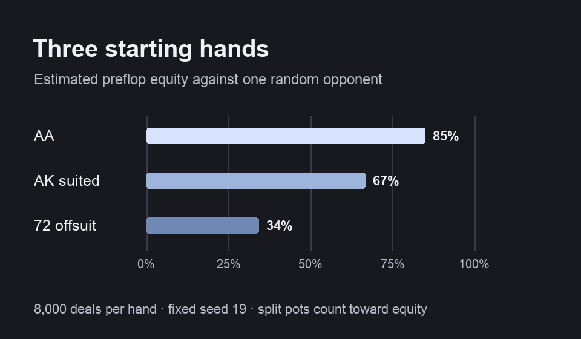

# Monte Carlo Poker Equity Simulator

This repository contains a Texas Hold'em Monte Carlo simulator built as a MITES Semester high-school research project. It estimates hand equity by repeatedly sampling unknown cards, evaluating every possible five-card poker hand, and comparing exact hand-strength tie breakers.

The goal is to make the project readable to quantitative analysis, research, and STEM reviewers: the code is deterministic when seeded, tested, documented, and packaged with a Streamlit interface for demos.

## What It Does

- Simulates pre-flop, flop, turn, and river scenarios.
- Supports 1 to 5 random opponents.
- Computes win, tie, loss, and split-pot equity rates.
- Evaluates the best five-card hand from five to seven available cards.
- Handles kicker tie breakers, wheel straights, flushes, full houses, straight flushes, and royal flushes.
- Calculates outs and one-card improvement odds after the flop or turn.
- Includes a benchmark tab for comparing common starting hands.

## Methodology

For each Monte Carlo trial:

1. Remove the known player and community cards from a standard 52-card deck.
2. Shuffle the unseen deck with an optional fixed random seed.
3. Deal random opponent hole cards and any missing community cards.
4. Enumerate all five-card combinations from each player's seven-card set.
5. Score each hand as `(category, tie_breakers)` so kickers and paired ranks are compared correctly.
6. Record whether the player wins, loses, or splits the pot.

Equity is reported separately from raw win rate. A tied pot contributes the correct fractional share to equity.

## Quick Start

```bash
python3 -m venv .venv
source .venv/bin/activate
pip install -r requirements.txt
streamlit run poker_sim_ui.py
```

Run the command-line demo:

```bash
python3 poker_sim_full.py
```

Run validation tests:

```bash
python3 -m unittest discover -s tests
```

## Project Structure

```text
poker_sim_full.py       Core simulator, hand evaluator, odds logic
poker_sim_ui.py         Streamlit dashboard for scenario testing
tests/                  Unit tests for rankings, ties, outs, and simulation rates
PROCESS.md              Project narrative, validation notes, and extension ideas
requirements.txt        Runtime dependencies
```

## Validation

The test suite checks:

- Royal flush and wheel straight detection.
- Seven-card best-hand selection.
- Kicker-based tie breaking.
- Duplicate-card rejection.
- Monte Carlo rates summing to 100%.
- Outs and one-card odds calculations.

## Limitations

This version assumes opponents are dealt random cards from the remaining deck. It does not yet model opponent ranges, betting actions, fold equity, position, bankroll risk, or strategy. The simulator estimates card equity, not full game-theory expected value.

## Example output

Seeded preflop comparison over 8,000 deals per hand against one random opponent. Ties count toward split-pot equity.


